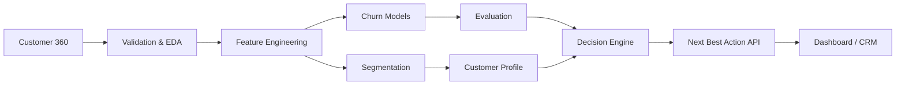

# Enterprise Customer Intelligence Platform

A production-oriented synthetic-data platform that combines customer analytics,
segmentation, churn prediction, model evaluation and next-best-action recommendations.

## Business outcome
Identify high-value customers at risk, explain the drivers, and recommend a
commercial action.

## Architecture


## Included
- 6,000 synthetic customer records
- Data validation and feature engineering
- Customer segmentation
- Logistic Regression, Random Forest and Gradient Boosting
- Cross-validation and metrics
- Business-oriented next-best-action logic
- FastAPI inference endpoint
- Unit tests, Docker and GitHub Actions
- Model/data governance documentation

## Run
```bash
pip install -r requirements.txt
python -m src.train
uvicorn src.api:app --reload
pytest -q
```

Synthetic data only. This project is for demonstration and portfolio use.
